# FZ-ASM Model Decision Workflow & Architecture Flowchart

This document details the step-by-step algorithmic thought process and decision tree executed by the **FZ-ASM Engine** for every candle update.

---

## 1. End-to-End Thought Process Flowchart

```mermaid
flowchart TD
    Start(["Start Scan Cycle"]) --> GateAsset{"Is Asset Supported?<br/>(JPY Crosses or XAUUSD)"}
    
    GateAsset -- "No" --> RejectAsset["Ignore Asset<br/>(Outside ASM Scope)"]
    GateAsset -- "Yes" --> GateSession{"Is Time in Asian Session?<br/>(00:00 - 06:00 UTC / 1:00 - 7:00 AM WAT)"}
    
    GateSession -- "No" --> WaitSession["Standby / Monitor for Next Session Open"]
    GateSession -- "Yes" --> CheckPrime["Check Volatility Window<br/>(Prime: 00:00 - 02:00 UTC)"]
    
    CheckPrime --> HTFBias["Stage 1: HTF Directional Bias<br/>(Evaluate D1 / 2D / 3D Daily Maps)"]
    
    HTFBias --> MapPrio{"Evaluate Daily Map Priority"}
    
    MapPrio -- "Priority 1" --> Map4["Map 4: CRT + Structural POI Confluence"]
    MapPrio -- "Priority 2" --> Map3["Map 3: Consecutive Leg + Sweep"]
    MapPrio -- "Priority 3" --> Map2["Map 2: Candle Range CRT (Swept High/Low)"]
    MapPrio -- "Priority 4" --> Map5["Map 5: Rejection (5A) / Sweep Invalidation (5B)"]
    MapPrio -- "Priority 5" --> Map1["Map 1: Structural Expansion & Order Transfer"]
    
    Map4 --> BiasConfirmed["Set HTF Bias State:<br/>- Bias: BULLISH or BEARISH<br/>- Origin: Where price came FROM<br/>- Target: Where price is going TO<br/>- 50% Equilibrium Level"]
    Map3 --> BiasConfirmed
    Map2 --> BiasConfirmed
    Map5 --> BiasConfirmed
    Map1 --> BiasConfirmed
    
    BiasConfirmed --> ITFRange["Stage 2: ITF Dealing Range & POIs<br/>(Scan H4 / H2 Candles)"]
    
    ITFRange --> DetectPOIs["Detect Active Key Levels:<br/>1. Order Blocks (with FVG validation)<br/>2. Breaker Blocks (body close violation)<br/>3. Open-Close Expansion Levels<br/>4. Engulfing Candle Power Units"]
    
    DetectPOIs --> AlignPOI{"Is Price Interacting with<br/>Unmitigated POI matching Bias?"}
    AlignPOI -- "No" --> WaitPOI["Wait for POI Mitigation / Pullback"]
    AlignPOI -- "Yes" --> H1Trigger["Stage 3: Hourly Session Sweep<br/>(1:00 AM or 2:00 AM H1 Candle)"]
    
    H1Trigger --> CheckSweep{"Did H1 Candle Sweep Previous H1?<br/>- Wick pierces prior high/low<br/>- Candle body closes back inside"}
    
    CheckSweep -- "No" --> FallbackH2{"Did H2 Candle Sweep?<br/>(FZ Fallback Rule)"}
    FallbackH2 -- "No" --> NoTrade["No Sweep Confirmed -> No Trade Forced"]
    FallbackH2 -- "Yes" --> SweepValid["Sweep Validated"]
    CheckSweep -- "Yes" --> SweepValid
    
    SweepValid --> AlignSweepBias{"Does Sweep Direction<br/>Align with HTF Map Bias?"}
    AlignSweepBias -- "No (Counter)" --> SkipSweep["Reject Sweep (Disagrees with HTF Map)"]
    AlignSweepBias -- "Yes" --> LTFExec["Stage 4: LTF Execution Engine<br/>(Drop to M15 / M10 / M5)"]
    
    LTFExec --> CheckModelA{"Model A: Did M15 print CHOCH?<br/>(Body close beyond minor swing)"}
    
    CheckModelA -- "Yes" --> TriggerModelA["Model A Confirmed:<br/>- Entry: Market / M15 FVG Retest<br/>- Stop Loss: Extreme H1 Sweep Wick + buffer<br/>- TP1: 50% Equilibrium<br/>- TP2: HTF Daily Map Target"]
    
    CheckModelA -- "No" --> CheckModelB{"Model B: Did M15 print Inducement?<br/>(Candle stalls just short of POI)"}
    
    CheckModelB -- "Yes" --> TriggerModelB["Model B Confirmed:<br/>- Entry: Limit order on POI boundary<br/>- Stop Loss: Past POI boundary + buffer<br/>- TP1: 50% Equilibrium<br/>- TP2: HTF Daily Map Target"]
    
    CheckModelB -- "No" --> WaitLTF["Wait for M15 Structure Confirmation"]
    
    TriggerModelA --> Dispatch["Stage 5: Dispatch Trade Setup<br/>- Send Notification to Telegram Mini App<br/>- Log Execution Event"]
    TriggerModelB --> Dispatch
    Dispatch --> Done(["Trade Setup Active"])
```

---

## 2. Explanation of the 5 Decision Stages

### Stage 1: Asset & Session Timing Gatekeeper
- **Symbol Check**: Strictly filters for the high-liquidity Asian session assets: JPY crosses (`USDJPY`, `AUDJPY`, `GBPJPY`, `CADJPY`, `EURJPY`, `CHFJPY`) and `XAUUSD` (Gold).
- **Session Check**: Ensures trading occurs during Asian hours (`00:00 - 06:00 UTC` / 1:00 AM - 7:00 AM WAT).
- **Prime Window**: Highlights the institutional entry surge between `00:00` and `02:00 UTC` (1:00 AM - 3:00 AM WAT).

### Stage 2: HTF Directional Bias (The 5 Daily Maps)
- Before checking lower timeframes, the engine determines **WHERE** the market is going using D1/2D/3D candles:
  1. **Map 4 (Confluence)**: CRT sweep occurring right within an ITF/HTF structural POI.
  2. **Map 3 (Consecutive Run Sweep)**: Directional run of $\ge 2$ candles swept at the extreme, targeting the run's origin.
  3. **Map 2 (CRT)**: Sweeping one daily boundary (e.g. low) and rejecting, targeting the opposing boundary (high).
  4. **Map 5 (Rejection vs. Sweep Invalidation)**: Clean bounce off POI (5A) or sweep invalidation (5B).
  5. **Map 1 (Structural Range & Order Transfer)**: Pro-trend expansion targeting swing extremes without requiring a deep 50% retrace when order blocks hold.

### Stage 3: ITF Range & Key Levels (H4 / H2)
- Scans Intermediate Timeframes (`H4` / `H2`) to define the current dealing range and detect unmitigated POIs:
  - **Order Blocks**: Last opposite candle prior to momentum expansion, validated with a **Fair Value Gap (FVG)**.
  - **Breaker Blocks**: Failed Order Blocks disrespected by a **candle body close**, flipping their polarity.
  - **Open-Close Levels**: Horizontal pivot boundaries formed by the bodies of expansion candles.
  - **Power Units**: Engulfing candles signaling institutional volume.

### Stage 4: Hourly Session Candle Sweep Trigger (H1 / H2)
- At the Asian open, evaluates whether the **1:00 AM candle sweeps the 12:00 AM candle** (or **2:00 AM sweeps 1:00 AM**):
  - Must penetrate with a **wick** and body-close back inside (rejection wick).
  - Must test or interact with the active Key Level.
  - **H2 Fallback**: If H1 is ambiguous, the engine checks the 2-Hour candle.

### Stage 5: Lower Timeframe Execution (M15 / M10 / M5)
- **Model A (Market Shift / CHOCH)**: M15 candle closes with body beyond the minor swing high/low that led into the sweep. Enter on market or FVG retest.
- **Model B (Candlestick Liquidity Inducement)**: An inducement candle leaves resting liquidity just short of the POI. Place a limit order on the POI boundary.
- **Risk Management**:
  - Stop loss pinned strictly behind the sweep extreme (plus buffer pips).
  - TP1 set at the 50% equilibrium level.
  - TP2 set at the macro HTF Map target.
